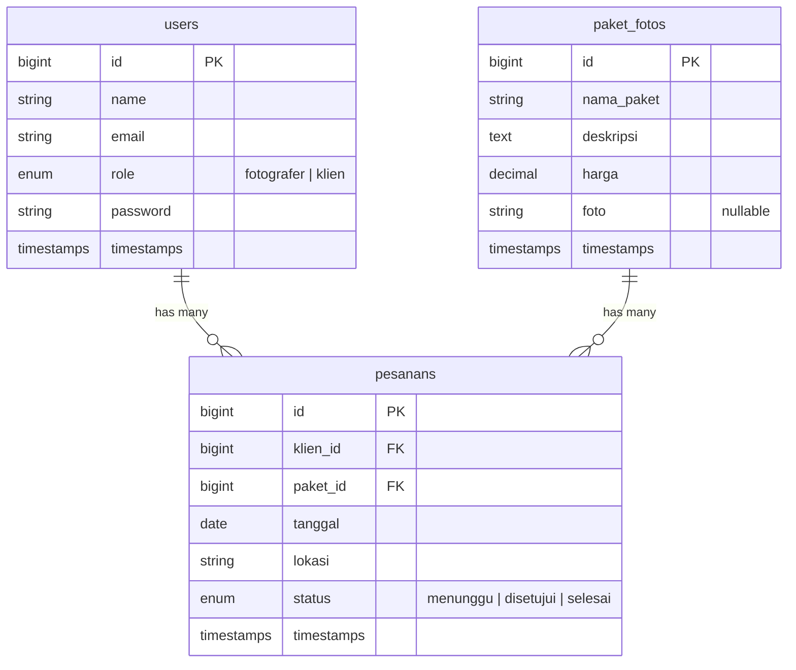

# 📸 JepretYuk - Panduan Backend Laravel

## Struktur File yang Dibuat

```
app/
├── Http/
│   ├── Controllers/
│   │   ├── AuthController.php          ← Login, Register, Logout
│   │   ├── PaketFotoController.php     ← CRUD Paket Foto (fotografer only)
│   │   └── PesananController.php       ← CRUD Pesanan (role-aware)
│   └── Middleware/
│       ├── RoleFotografer.php           ← Guard: hanya role fotografer
│       └── RoleKlien.php               ← Guard: hanya role klien
├── Models/
│   ├── User.php                        ← + kolom role, relasi hasMany pesanan
│   ├── PaketFoto.php                   ← hasMany pesanan
│   └── Pesanan.php                     ← belongsTo klien & paketFoto
bootstrap/
│   └── app.php                         ← Middleware alias + custom error handling
database/
│   └── migrations/
│       ├── ..._add_role_to_users_table.php
│       ├── ..._create_paket_fotos_table.php
│       └── ..._create_pesanans_table.php
routes/
│   └── web.php                         ← Semua route (auth, fotografer, klien)
resources/
│   └── views/errors/
│       ├── 403.blade.php               ← Placeholder error page
│       ├── 404.blade.php               ← Placeholder error page
│       └── 500.blade.php               ← Placeholder error page
```

---

## Diagram Relasi Database (ERD)



---

## Alur Route & Middleware

| Grup | Prefix | Middleware | Route | Controller Method |
|------|--------|-----------|-------|-------------------|
| **Auth** | `/` | `guest` | `GET /register` | `AuthController@showRegister` |
| | | `guest` | `POST /register` | `AuthController@register` |
| | | `guest` | `GET /login` | `AuthController@showLogin` |
| | | `guest` | `POST /login` | `AuthController@login` |
| | | `auth` | `POST /logout` | `AuthController@logout` |
| **Fotografer** | `/fotografer` | `auth`, `role.fotografer` | `GET /paket` | `PaketFotoController@index` |
| | | | `GET /paket/create` | `PaketFotoController@create` |
| | | | `POST /paket` | `PaketFotoController@store` |
| | | | `GET /paket/{paket}/edit` | `PaketFotoController@edit` |
| | | | `PUT /paket/{paket}` | `PaketFotoController@update` |
| | | | `DELETE /paket/{paket}` | `PaketFotoController@destroy` |
| | | | `GET /pesanan` | `PesananController@index` |
| | | | `GET /pesanan/{pesanan}/edit` | `PesananController@edit` |
| | | | `PUT /pesanan/{pesanan}` | `PesananController@update` |
| | | | `DELETE /pesanan/{pesanan}` | `PesananController@destroy` |
| **Klien** | `/klien` | `auth`, `role.klien` | `GET /pesanan` | `PesananController@index` |
| | | | `GET /pesanan/create` | `PesananController@create` |
| | | | `POST /pesanan` | `PesananController@store` |
| | | | `GET /pesanan/{pesanan}/edit` | `PesananController@edit` |
| | | | `PUT /pesanan/{pesanan}` | `PesananController@update` |
| | | | `DELETE /pesanan/{pesanan}` | `PesananController@destroy` |

---

## Logika Bisnis Utama

### PesananController - Aturan Akses per Role

| Aksi | Fotografer | Klien |
|------|-----------|-------|
| **Lihat pesanan** | Semua pesanan dari semua klien | Hanya pesanan milik sendiri |
| **Buat pesanan** | ❌ Tidak bisa | ✅ Bisa buat pesanan baru |
| **Edit pesanan** | Ubah **status** pesanan manapun | Ubah **detail** pesanan sendiri (hanya jika status masih `menunggu`) |
| **Hapus pesanan** | Hapus pesanan manapun | Hapus pesanan sendiri (hanya jika status masih `menunggu`) |

---

## Daftar View yang Perlu Dibuat (untuk Teman Kelompok)

> [!IMPORTANT]
> Semua `return view(...)` di Controller sudah memanggil nama view berikut. Teman kelompok tinggal membuat file Blade-nya.

| View Name | File Path | Dipakai di Controller |
|-----------|-----------|----------------------|
| `welcome` | `resources/views/welcome.blade.php` | Halaman utama |
| `auth.register` | `resources/views/auth/register.blade.php` | `AuthController@showRegister` |
| `auth.login` | `resources/views/auth/login.blade.php` | `AuthController@showLogin` |
| `paket.index` | `resources/views/paket/index.blade.php` | `PaketFotoController@index` |
| `paket.create` | `resources/views/paket/create.blade.php` | `PaketFotoController@create` |
| `paket.edit` | `resources/views/paket/edit.blade.php` | `PaketFotoController@edit` |
| `pesanan.index` | `resources/views/pesanan/index.blade.php` | `PesananController@index` |
| `pesanan.create` | `resources/views/pesanan/create.blade.php` | `PesananController@create` |
| `pesanan.edit` | `resources/views/pesanan/edit.blade.php` | `PesananController@edit` |
| `errors.403` | `resources/views/errors/403.blade.php` | Custom error handler |
| `errors.404` | `resources/views/errors/404.blade.php` | Custom error handler |
| `errors.500` | `resources/views/errors/500.blade.php` | Custom error handler |

### Variabel yang Dikirim ke Setiap View

```php
// paket.index   → compact('pakets')         // Collection of PaketFoto
// paket.edit    → compact('paket')           // Single PaketFoto instance
// pesanan.index → compact('pesanans')        // Collection of Pesanan (with relations)
// pesanan.create→ compact('pakets')          // Collection of PaketFoto (for dropdown)
// pesanan.edit  → compact('pesanan', 'pakets') // Single Pesanan + all PaketFoto
```

---

## Custom Error Handling

> [!NOTE]
> Error handling dikonfigurasi di [`bootstrap/app.php`](file:///d:/Codes/UTP%20PWL/bootstrap/app.php). Pastikan di file `.env` set `APP_DEBUG=false` saat production agar error 500 diarahkan ke view custom.

| Error | Trigger | View |
|-------|---------|------|
| **404** | URL tidak ditemukan | `errors.404` |
| **403** | Akses ditolak | `errors.403` |
| **500** | Error server (production only) | `errors.500` |

---

## Cara Setup di Proyek Laravel

```bash
# 1. Buat proyek Laravel baru (jika belum ada)
composer create-project laravel/laravel jepretyuk

# 2. Copy semua file dari struktur ini ke proyek Laravel

# 3. Konfigurasi database di .env
DB_DATABASE=jepretyuk
DB_USERNAME=root
DB_PASSWORD=

# 4. Jalankan migrasi
php artisan migrate

# 5. Buat symbolic link untuk storage (upload foto)
php artisan storage:link

# 6. Jalankan server
php artisan serve
```
